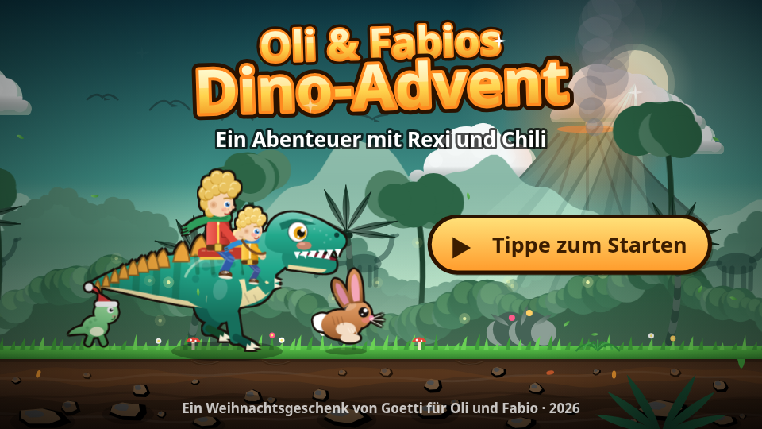
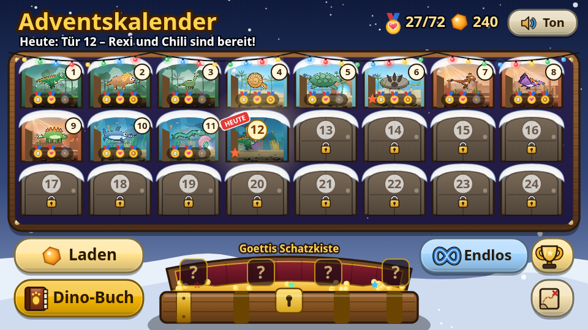
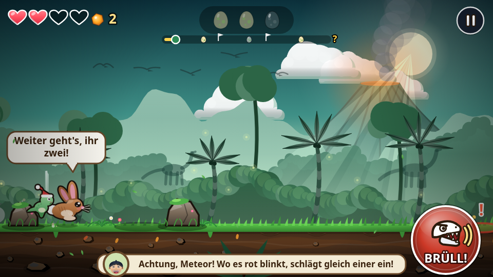
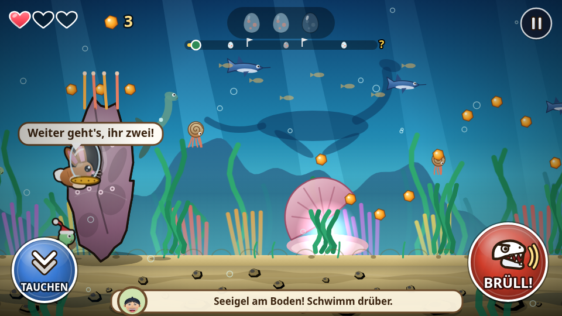
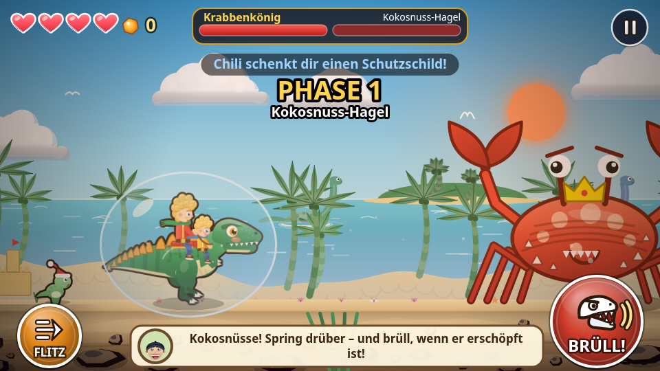
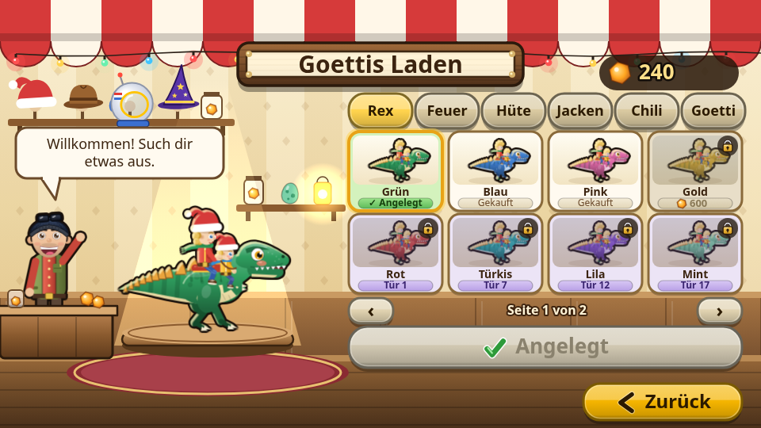
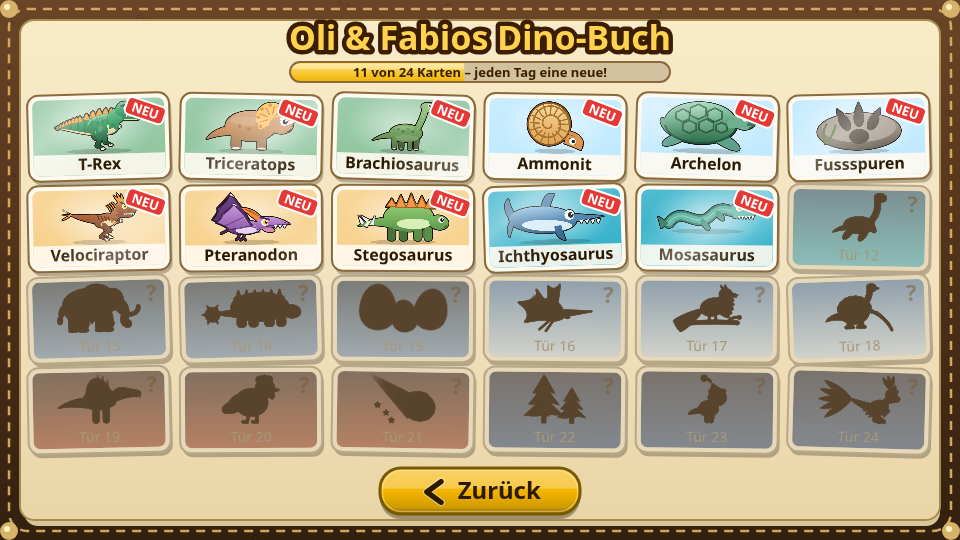

# Oli & Fabios Dino-Advent

**A Christmas advent-calendar game for two brothers.** Oli steers a T-Rex that the kids name themselves at the start, Fabio sits in front and roars, and Chili the rabbit hops along. Together they save dinosaurs, one door a day from **1 to 24 December**.

## ▶ Play now

**<https://saschaandresgrimm.github.io/dino-advent/>**

Open the link in any modern browser (tablet, phone or computer). There is nothing to install or sign up for. Tap **Tippe zum Starten** and go.

> The game is in **German**. The levels are short and hints appear in short speech bubbles, so it is easy to follow along.

## How it works

- **24 doors, one per day.** Door N opens on December N. Before 1 December the calendar shows a countdown. Missed days stay playable, so nobody falls behind.
- **Each door is a short level** (about 2 minutes): run, jump and roar through the jungle, beach, canyon, deep sea, ice age, mountains, a volcano and finally a Christmas night.
- **Every door hides a gift:** a hat, a new colour for your T-Rex or a fire colour, plus a new card for the Dino-Buch.
- **New skills as you go:** double jump, dash (day 4), duck (7), swim (10), ground pound (13), glide (16) and fire breath (19).
- **Four boss fights** on days 6, 12, 18 and 24. The last door holds the Krallenkönig, the golden egg and the Christmas ending.
- Götti's shop, a collectible Dino-Buch, riddles, an endless run and a daily run keep it fun after the story is done.

| | |
|---|---|
|  |  |
| **The calendar:** a new door opens every day | **Jungle:** jump, roar and collect amber |
|  |  |
| **Underwater:** days 10 to 12 | **Boss fights:** each one has several phases |
|  |  |
| **Göttis Laden:** hats, colours and real-life vouchers | **Dino-Buch:** 24 cards with real dino facts |

## Controls

| Action | Touch | Keyboard | From day |
|---|---|---|---|
| Jump (tap twice to double jump) | tap the screen | Space, ↑ or W | 1 |
| Roar: scares enemies, smashes boulders | **BRÜLL!** | R, X or → | 1 |
| Dash through walls, waves and enemies | **FLITZ** | F, Shift or ← | 4 |
| Duck under low branches and flyers | **DUCKEN** | ↓ or S | 7 |
| Swim up (tap) or down | tap / **TAUCHEN** | Space / ↓ | 10 |
| Ground pound (in the air) | **STAMPF** | ↓ or S | 13 |
| Glide (hold in the air) | hold | hold Space | 16 |
| Fire breath (after a Feuer-Chili) | **FEUER!** | R | 19 |
| Pause | ⏸ | Esc | |

## Install it on a tablet

Playing in the browser works fine, but installing gives a full-screen app that also works **offline**.

- **iPad / iPhone:** open the link in Safari → Share → **Zum Home-Bildschirm**.
- **Android:** open the link in Chrome → ⋮ → **App installieren**.
- **Computer (Chrome, Edge):** click the install icon in the address bar.

Turn the device to landscape. Progress is saved on the device.

## Good to know (parents)

- **Progress is saved in the browser on that device.** Clearing the site data or switching browsers starts a new save. There are no accounts and no network traffic: nothing leaves the device, and names stay local.
- **Try other days:** press and hold the title "Adventskalender" on the calendar for 1.5 seconds to open parent mode. There you can set the day, open all doors or clear the high-score list. Adding `?day=12` to the address pretends it is 12 December without touching the save.
- **Calm mode** in the settings turns off screen shake and red flashes.
- **Updates:** the game updates itself when you open it with an internet connection.

## For developers and maintainers

| Document | For |
|---|---|
| [docs/DEVELOPMENT.md](docs/DEVELOPMENT.md) | Run, test and change the game |
| [docs/ARCHITECTURE.md](docs/ARCHITECTURE.md) | How the code in `js/` is organised |
| [docs/MAINTENANCE.md](docs/MAINTENANCE.md) | Releases, deployment, yearly rollover, dependencies |
| [CLAUDE.md](CLAUDE.md) | Project rules for AI coding agents |

Quick start: `npm install && npx playwright install chromium && npm run serve`, then open <http://localhost:8765>.

## Credits

A Christmas present for Oli and Fabio. Licensed under the [MIT License](LICENSE). Plain HTML, Canvas 2D and synthesised sound: no build step, no external assets, no tracking.
